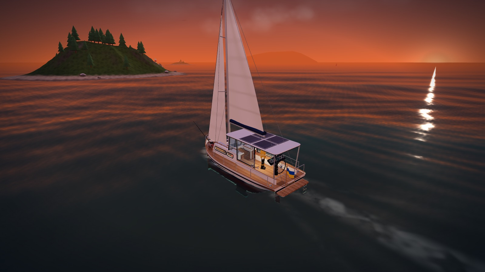
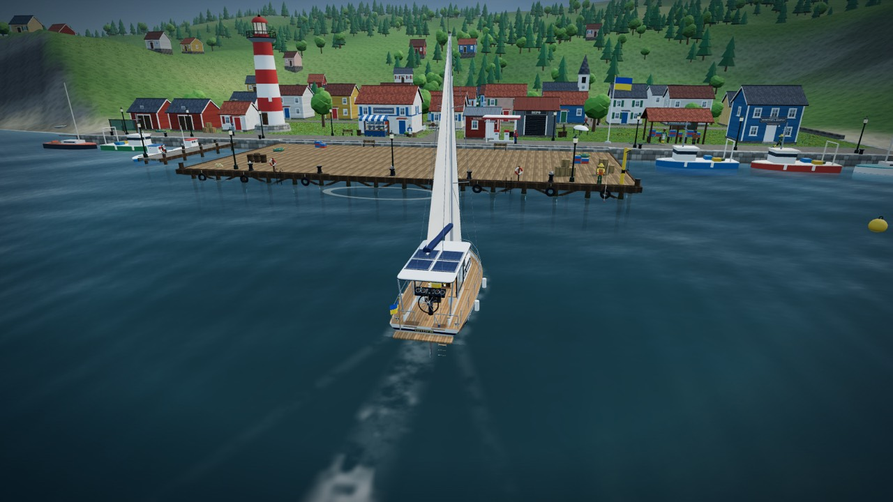
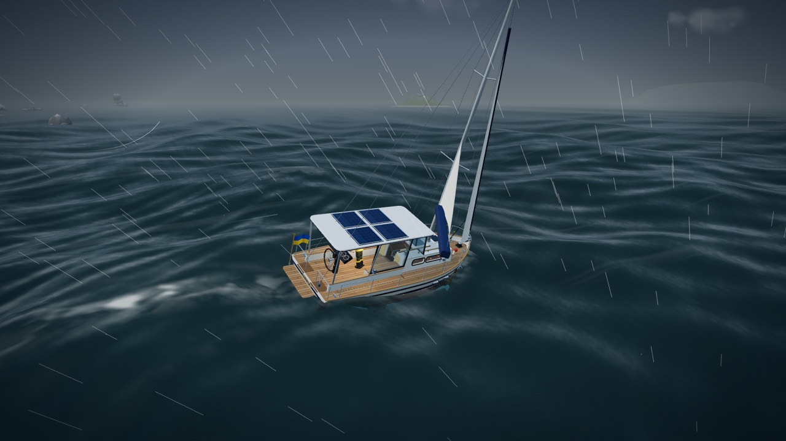
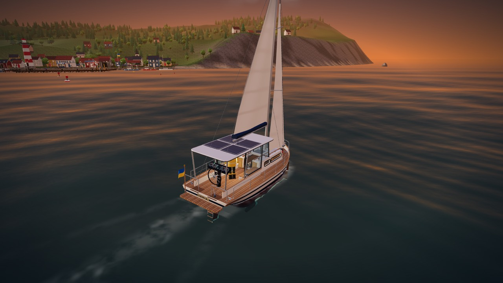
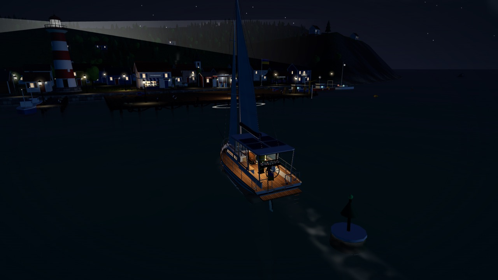
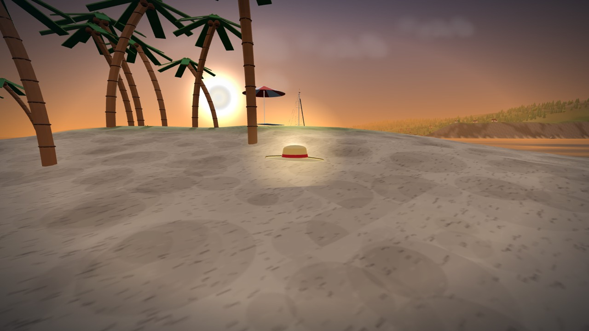
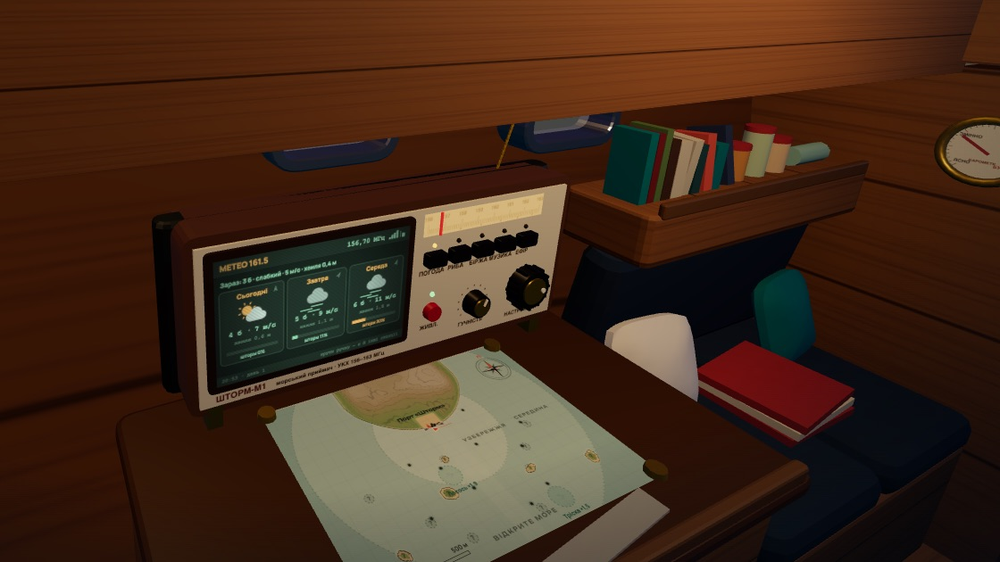
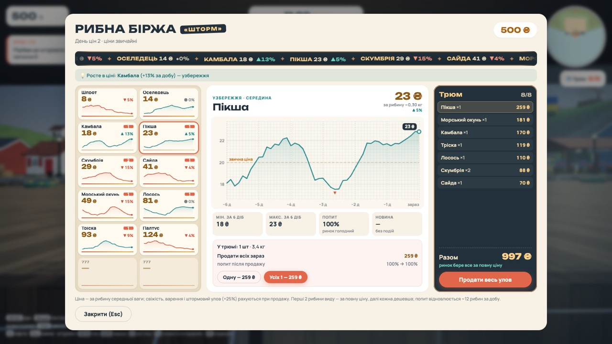
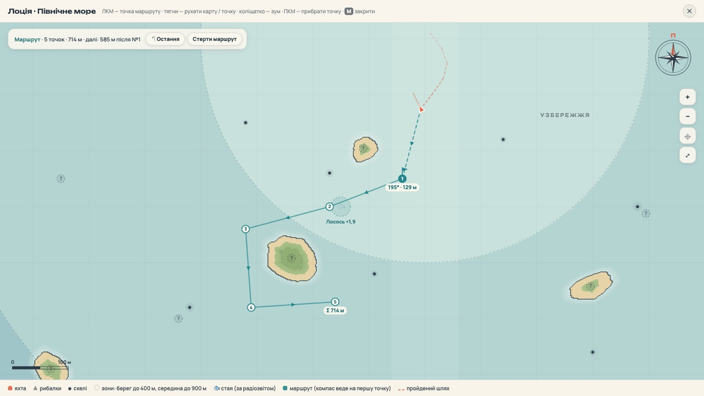

<div align="center">

# ⛵ Storm Fishers · Грозова рибалка

**A cozy 3D sailing & fishing game that runs right in your browser — alone or with friends.**

Take your little yacht out of a sleepy northern harbour, chase fish schools across open water,
explore islands, outrun Beaufort‑scale storms and come home with a hold full of catch.

### [▶ Play now — thealexpg.github.io/storm-fishers](https://thealexpg.github.io/storm-fishers/)


<br>



</div>

---

## 📸 Screenshots

<table>
  <tr>
    <td width="50%"><br><sub><b>Port «Шторм»</b> — the lighthouse, the quay and the local fishing fleet</sub></td>
    <td width="50%"><br><sub><b>Storm</b> — 10–11 Beaufort out in the open sea</sub></td>
  </tr>
  <tr>
    <td><br><sub><b>Golden hour</b> — heading home with the catch</sub></td>
    <td><br><sub><b>Night</b> — lighthouse beam, cabin lights, running lights</sub></td>
  </tr>
  <tr>
    <td><br><sub><b>Islands</b> — go ashore and find hidden hats and treasure</sub></td>
    <td><br><sub><b>Cabin radio «Шторм‑М1»</b> — 3‑day forecast, market, music</sub></td>
  </tr>
  <tr>
    <td><br><sub><b>Fish exchange</b> — price history, demand and your hold's value</sub></td>
    <td><br><sub><b>Nautical chart</b> — zoom, pan and plot a route between the islands</sub></td>
  </tr>
</table>

---

## ✨ Features

### 🌊 The sea
- **Living ocean** — Gerstner waves that grow from harbour ripples to 14‑metre swells offshore, refractive transparent water, foam, spray and rain.
- **Weather that matters** — wind and sea state on the Beaufort scale and a day/night cycle with sunsets, a lighthouse and running lights.
- **Long, readable weather cycles** — 8–14 minutes of fair weather, a front that builds for a few minutes, then a 5–8 minute storm that slowly eases. The radio warns you about 8–9 minutes before it hits, so there's time to reef and run for port.
- **Rough waters** — three dangerous regions (the Storm Belt, the Shell Reefs and the Open Ocean) have higher seas and turn every front into a real storm. One weather system covers the whole sea, so between storms they are calm enough to fish; you get a warning about 7–9 minutes ahead, and every harbour is a safe haven.
- **Wave slamming** — punch head‑on into big seas at full throttle and the hull takes damage; take them at an angle like a real sailor.

### ⛵ The yacht
- **Sailing physics** — keel, sails trimmed to the apparent wind, a sail wheel at the mast to set exactly how much canvas you carry (two reefs, full sail, gennaker) with a suggestion for the current wind, gybes, a motor for the harbour, fuel, rudder and throttle at a real wheel.
- **Walk the whole boat** — deck, cockpit and a cabin below with closable companionway doors (leave them open in a storm and water gets in!).
- **A cozy cabin** — settees with cushions, rugs, bookshelves, a ship in a bottle, a swinging oil lantern, and a clock and barometer that follow the game time and the weather.
- **Physical radio «Шторм‑М1»** — a real set with a screen and separate controls: power, five preset buttons, a tuning knob (with static between stations) and a volume knob. Aim at a control and click it, or turn it with the mouse wheel. Its screen shows a 3‑day forecast, market prices with sparklines, fish reports, a live music spectrum or typed‑out channel 16 chatter.
- **Chart table** — lean over a paper chart in the cabin, zoom it and plot your course with a pencil.
- **Upgrades you can see** — hull, sails, hold, rods, nets: every level physically changes the boat.
- **Mooring & gangway** — step ashore and back aboard without climbing over the rails.

### 🎣 Fishing
- **Rod mini‑game** — power cast, strike on the bite, fight the fish with line tension and rod angle; rod holders for several rods at once.
- **Physical catch** — fish flop on deck, can be washed overboard, and are carried by hand to the fish box or the hold.
- **Commercial nets** (mid/end‑game) — set drift nets from the stern drum, mark them with buoys, come back hours later and haul the catch. Storms can tear them.
- **12 species** across shore, mid‑water and open‑sea zones, with radio reports of where the schools are biting today.
- **Fishing grounds** — four marked spots where the fish run 1.5–2.5× heavier and trophies are far more common. The richest ones lie deep inside the rough waters. They appear on the chart as sailors' rumours with a risk rating (⚠ to ⚠⚠⚠) until you find them.

### 🏝️ Islands & treasure
- **A sea worth crossing** — about 3.4 × 2.6 km of open water. The nearest harbour is under a kilometre from home, the farthest, the whaling station, about 2 km.
- **Five islands to explore** — a gull rock, a pine island with a ruined keeper's hut, a palm spit, a pirate cove and a shell island, each with its own props.
- **Go ashore** — bring the boat in close, press **E** and walk the beaches and hills; the yacht holds its position while you're away, and you can always get back aboard.
- **Hidden hats & treasure** — find an ushanka, a sou'wester, a straw hat, a pirate tricorn and a crown of shells (plus a bonus hat for discovering every island), message bottles and a pirate chest.
- **Wardrobe** — pick your hat in the pause menu; in co‑op your friends see it too.

### 🗺️ Navigation
- **Full‑screen nautical chart (M)** — zoom with the mouse wheel, drag to pan, plot **multi‑point routes**; the compass leads you to the next waypoint and advances automatically.
- **Minimap, compass tape, bearing & distance chips**, your sailed track and discovered landmarks.

### 🏪 The harbour economy
- **A real harbour, not one magic menu** — each service has its own place on the quay: the **fish exchange** (the only place that buys fish), the **chandlery** for gear and upgrades, the **fuel kiosk**, the **shipyard** for hull repairs and the **harbour office** for insurance.
- **Fish exchange** — a scrolling price ticker, cards for every species with sparklines and trend arrows, a big 6‑day price chart on graph paper, demand bars (sell too much of one species and its price sinks, then slowly recovers), market events, and a hold panel with your catch's projected value.
- **Local fishing fleet** — five NPC boats («Ластівка», «Стара Марта», «Дельфін», «Чайка», «Бриз») leave port, fish the grounds and come back. When a storm is forecast they all run for the harbour. They steer around rocks, islands and you, sound their horns as they pass and chat on the radio.

### 👥 Co‑op
- **Play with friends over the internet** — no server, no accounts: browsers connect peer‑to‑peer (WebRTC). Share a 4‑letter room code or an invite link.
- **A fleet, not just one boat** — everyone can come on their own yacht with their own progress, or join someone's crew. Four friends? Two boats, two sailors each.
- **Shared hold per boat** — the crew loads the catch together; whoever sells it gets the money.
- Text chat, coloured avatars, friends on the map.

### 🏠 Home
- **Your own cottage** by the home quay — walk right in through the open door: a bed with a checked quilt, a crackling iron stove, a table by the window, a trophy fish on the wall. Sleep in the bed to skip to morning (the game saves).
- **Captain's log** — a cork board on the wall with your earnings, distance sailed, catch and a chart of where you've been; press **E** to open the full log: income and spending by day (14-day chart, best day, where the money came from and went), voyages (distance, time at sea, farthest point, places and ports), your fish collection with record weights, trophies, finds and every yacht upgrade.

### 💾 Progress
- Autosave in the browser, plus **save export/import** to move your progress to another computer.

### 🌍 Languages
- **English** (default) and **Ukrainian** — switch with the EN | UA toggle on the title screen or in the pause menu, or open the game with `?lang=uk` / `?lang=en`. In co-op every player sees the game in their own language.

---

## 🎮 Controls

| Key | Action |
|---|---|
| **W A S D** | walk · throttle & rudder at the wheel |
| **Mouse** | look around |
| **Hold RMB** | binoculars ×2 — read the radio, scan the horizon |
| **E** | interact (wheel, sails, doors, shops, chart table, nets…) · go ashore / back aboard |
| **E at the mast** | sail wheel — drop, reef 2 (40 %), reef 1 (70 %), full, gennaker · pick with the mouse or **1–5**, haul with **LMB** / **E** |
| **LMB** | cast / strike · place a route point on the chart |
| **Space** | reel in during a fight · jump |
| **A / D** | tilt the rod while fighting |
| **R** | reel in the line |
| **M** | nautical chart (wheel — zoom, drag — pan, click — add route point, RMB — remove) |
| **Radio** | aim at a button or knob · **LMB** press · **RMB** back · **wheel** turn |
| **V** | stern chase camera / first person at the wheel |
| **P** · **H** | photo mode · hide the interface |
| **Enter** | co‑op chat |
| **Esc** | pause menu (settings, co‑op, boats, hats, save export) |
| **F1** | show hints |

---

## 🚀 Run it locally

```bash
npm ci
npm run dev          # http://localhost:5173 (co-op relay on the same port at /net)
```

Production build: `npm run build` → `dist/`. `npm run serve` builds it and serves it together with the co‑op relay.

### How co‑op networking works
On static hosting (GitHub Pages) players connect **directly** via WebRTC using [PeerJS](https://peerjs.com/) —
the public broker only introduces browsers to each other; no game data passes through it.
When a local relay is available (`npm run dev` / `npm run serve` → `server/relay.mjs`) the game uses it instead.
Add `?p2p=1` to force direct connections, or `?room=CODE` to join a room from a link.

In a room the host keeps the world clock and weather; each boat owner simulates their own yacht and streams it to the crew and other players.

---

## 🛠 Tech

- **Three.js** (r161) with hand‑written GLSL for the ocean, no post‑processing stack.
- **TypeScript + Vite**; the only runtime dependencies are `three` and `peerjs`.
- Procedural sound and music via the Web Audio API.
- Everything — models, textures, the paper chart — is generated in code.

```
src/
  core/    ocean, weather, time, input, audio, music
  world/   yacht, sails, cabin & radio, port, islands, NPC boats, nets, avatars
  game/    state & saves, fish, fishing, market, upgrades, insurance
  net/     co-op session (relay / P2P) and fleet sync
  ui/      HUD, chart (map), minimap, dialogs, exchange
```

---

## 📜 License

Storm Fishers is free and open source under the [MIT License](LICENSE) — play it, fork it, mod it, learn from it, ship your own version. Contributions and ideas are welcome!

---

<div align="center">

Made with ☕ and sea spray · in English and Ukrainian 🇺🇦

</div>
